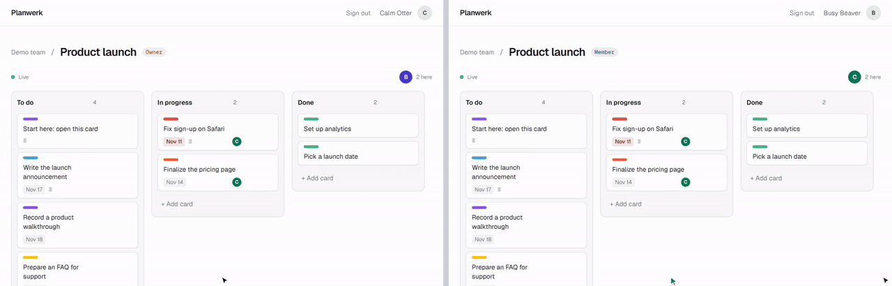
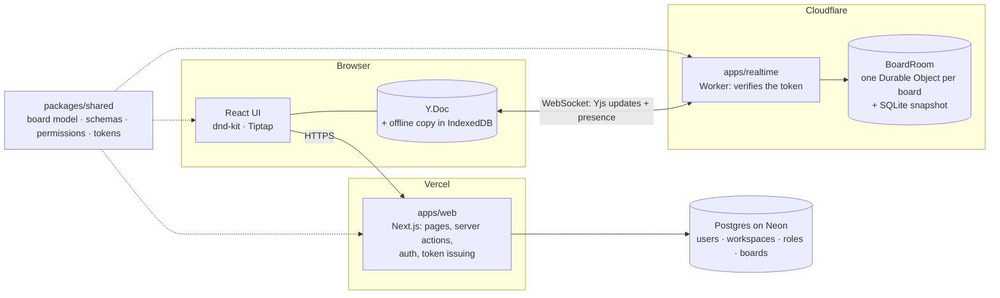
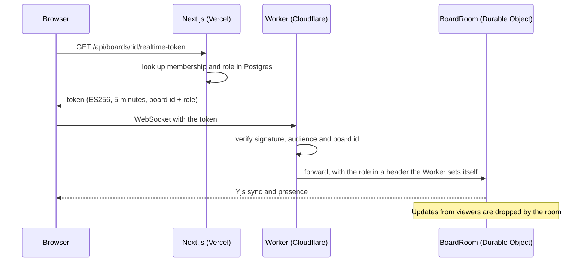

# Planwerk

**A realtime collaborative board for teams and shared flats.** Plan together, see every change instantly, keep working offline.

**Live:** [planwerk-ten.vercel.app](https://planwerk-ten.vercel.app) (click "Try the demo", no sign-up needed) · Realtime health check: [planwerk-realtime.plan-werk.workers.dev/health](https://planwerk-realtime.plan-werk.workers.dev/health)



_Two windows, two accounts, one board. Recorded from the end-to-end test stack with [`pnpm record-demo`](apps/web/e2e/readme-demo.record.ts)._

## Features

- **Live sync**: columns and cards update instantly for everyone, conflict-free thanks to CRDTs
- **Drag & drop** with mouse, touch and keyboard, with screen reader announcements
- **Presence**: see who is on the board, their mouse pointer and their text cursor
- **Card details**: collaborative rich-text descriptions, assignee, due date and labels
- **Offline editing**: if the connection drops, keep working; changes survive a reload and merge when you're back ([ADR 8](docs/adr/0008-offline-copy-in-indexeddb.md))
- **Workspaces & roles**: owner, member and read-only viewer, enforced by the realtime server with signed board tokens ([ADR 7](docs/adr/0007-board-access-tokens.md))
- **Demo and guest sessions**: "Try the demo" opens a board with example cards; guests can sign in with GitHub later and keep everything

## Tech stack

| Area     | Choice                                                   |
| -------- | -------------------------------------------------------- |
| Monorepo | pnpm workspaces, Turborepo                               |
| Web app  | Next.js (App Router), React, TypeScript (strict)         |
| Styling  | Tailwind CSS                                             |
| Auth     | Better Auth (GitHub OAuth, guest sessions)               |
| Database | Postgres on Neon, Drizzle ORM                            |
| Realtime | Yjs (CRDT) on Cloudflare Durable Objects (y-partyserver) |
| Shared   | Zod schemas and domain logic shared by client and server |
| Testing  | Vitest, PGlite, workerd, Playwright, axe-core            |
| Quality  | ESLint, Prettier, GitHub Actions CI, Dependabot          |

## Architecture



- **Relational data** (users, workspaces, memberships, roles, invitations) lives in Postgres and is served by the Next.js app.
- **Board content** (columns, cards, descriptions) is a Yjs document. Every board has its own Durable Object: all clients of a board connect to it, and it persists the document in its own SQLite storage.
- **The two halves meet in a signed token.** Only the web app knows who is a member, only the Worker holds the board. The web app signs a short-lived token with the user's role; the Worker checks it with the public key.

Opening a board:



The reasoning behind these choices is recorded in [Architecture Decision Records](docs/adr).

## Project structure

```
apps/
  web/        Next.js frontend and API
  realtime/   Cloudflare Worker with one Durable Object per board
packages/
  shared/     Domain types, Zod schemas, permission rules
docs/
  adr/        Architecture Decision Records
  ROADMAP.md
```

## Getting started

Requirements: Node.js 24+, pnpm, and access to the Vercel project (for the database credentials).

```bash
pnpm install
cd apps/web
vercel link          # once
vercel env pull      # writes apps/web/.env.local
pnpm db:migrate
pnpm realtime-keys local   # key pair for realtime board tokens
cd ../..
pnpm dev
```

See [`.env.example`](.env.example) for all variables. GitHub sign-in is optional locally; "Try the demo" and "Try it as a guest" always work.

Tests need no credentials at all: database tests run against PGlite, the realtime tests against a local `workerd`.

- Web app: http://localhost:3000
- Realtime Worker: ws://localhost:8787 (health check: http://localhost:8787/health)

## Scripts

| Command          | What it does                                     |
| ---------------- | ------------------------------------------------ |
| `pnpm dev`       | Start all apps in watch mode                     |
| `pnpm build`     | Build all apps                                   |
| `pnpm test`      | Run all unit and integration tests               |
| `pnpm lint`      | Lint all packages                                |
| `pnpm typecheck` | Type-check all packages                          |
| `pnpm check`     | Everything CI runs: lint, typecheck, test, build |
| `pnpm format`    | Format the codebase with Prettier                |

The realtime Worker runs locally in `workerd` via Wrangler, so no Cloudflare account is needed for development.

## Deployment

- **Web app** → Vercel (project root: `apps/web`), deployed on every push; pull requests get preview deployments
- **Realtime Worker** → Cloudflare Workers, deployed by GitHub Actions after green checks on every push to `main` (needs the `CLOUDFLARE_API_TOKEN` and `CLOUDFLARE_ACCOUNT_ID` repository secrets)

## Testing

Each layer is tested where it runs, without mocks:

| Layer                      | Tool                           | What it covers                                                                           |
| -------------------------- | ------------------------------ | ---------------------------------------------------------------------------------------- |
| Board model, tokens        | Vitest                         | CRDT operations incl. concurrent edits, token signing and verification                   |
| Workspaces, roles, invites | Vitest + PGlite                | Domain rules against real Postgres with the production migrations                        |
| Realtime Worker            | Vitest + workerd               | Sync between real WebSocket clients, persistence, token checks, a tampered viewer client |
| Whole app                  | Playwright + Postgres (Docker) | Two browsers on one board, keyboard drag and drop, viewers, non-members, touch screens   |
| Accessibility              | axe-core in Playwright         | WCAG 2.1 A/AA checks on every page, in light and dark mode                               |

```bash
pnpm check   # lint, typecheck, unit and integration tests, build
pnpm e2e     # end-to-end tests; starts Postgres in Docker, the Worker and a production build
pnpm --filter @planwerk/web record-demo   # records docs/media/planwerk-demo.gif (needs ffmpeg)
```

The end-to-end tests refuse to run against anything but a local database.

Lighthouse on the public pages (production): performance 98–99, accessibility 100, best practices 100, SEO 100.

## What was hard

Things that took longer than expected, and what they changed.

- **Boards that emptied themselves after a break.** New boards get their default columns from the server. The seed was only written to storage on the first edit, so after a room slept (Durable Object hibernation) it seeded again with a new Yjs client id. Yjs resolved the duplicate map keys by deleting one version, and because a woken room only asks clients for updates, browsers received the deletion of their columns but never the replacement. The fix is one line (save the snapshot right after seeding); finding it was the hard part. A regression test now checks for a snapshot before anyone edits. ([ADR 6](docs/adr/0006-board-document-model.md#addendum-the-seed-must-be-persisted-immediately-2026-11-08))
- **Hosting realtime for free.** The first plan was a Hocuspocus server on Node.js, but there was no free host left for a long-running WebSocket server. The realtime layer moved to Cloudflare Durable Objects: one instance per board, with its own SQLite storage and hibernation, which also removed the need for a separate document database. ([ADR 2](docs/adr/0002-yjs-and-hocuspocus-for-realtime.md), [ADR 4](docs/adr/0004-cloudflare-durable-objects-for-realtime.md))
- **Read-only has to be enforced by the server.** Hiding buttons does not stop a viewer from sending Yjs updates from the browser console. Roles travel in a signed token, the Worker verifies it, and the room drops updates from read-only connections. An integration test connects a tampered viewer client and checks that nothing it writes reaches anyone. ([ADR 7](docs/adr/0007-board-access-tokens.md))
- **Two features, one presence field.** Tiptap's collaboration caret stores the text selection in the Yjs awareness field `cursor`, which the board already used for mouse pointers. The two would have overwritten each other, so the board pointer moved to its own field (`pointer`); both share the same user object.
- **React Strict Mode and WebSockets.** In development React mounts effects twice. The provider was destroyed in the first cleanup, but its pending connection revived it, leaving a second connection per tab. The provider is now created on the next tick, so an immediate cleanup cancels it before it starts. A related bug: a native `<dialog>` closed itself because the effect cleanup called `close()`.
- **Clicks before hydration.** On a slow connection, the guest sign-in button did nothing if it was clicked before React had hydrated. Sign-in and the demo now use server actions behind plain forms, which work as soon as the HTML has arrived.
- **Offline data on shared computers.** Keeping a copy of every board in IndexedDB is great until someone signs out on a shared laptop. Local copies are tracked per user and removed on sign-out and when the server denies access. ([ADR 8](docs/adr/0008-offline-copy-in-indexeddb.md))
- **Accessibility details.** axe found contrast failures caused by opacity (`text-foreground/40` looked fine but measured below 4.5:1), card actions that only appeared on hover were invisible on touch screens, and moving cards between columns with the keyboard needed a custom coordinate getter for dnd-kit, plus announcements that use card titles instead of ids.

## License

[MIT](LICENSE)
