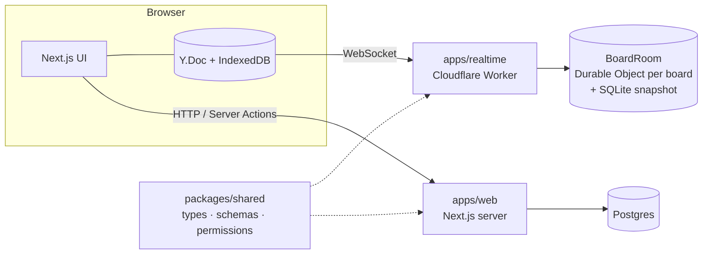

# Planwerk

**A realtime collaborative board for teams and shared flats.** Plan together, see every change instantly, keep working offline.

> 🚧 Work in progress: the foundation (Phase 0) is live, **Phase 1 (auth & workspaces)** is next. See the [roadmap](docs/ROADMAP.md).

**Live:** [planwerk-ten.vercel.app](https://planwerk-ten.vercel.app) · Realtime health check: [planwerk-realtime.plan-werk.workers.dev/health](https://planwerk-realtime.plan-werk.workers.dev/health)

## Features (planned for v1)

- **Live sync**: boards, columns and cards update instantly for everyone, conflict-free thanks to CRDTs
- **Presence**: see who is on the board and where their cursor is
- **Collaborative rich text** for card descriptions
- **Offline first**: keep working without a connection, changes merge on reconnect
- **Workspaces & roles**: owner, member and read-only viewer, enforced on the server
- **Guest demo**: try it without signing up

## Tech stack

| Area     | Choice                                                   |
| -------- | -------------------------------------------------------- |
| Monorepo | pnpm workspaces, Turborepo                               |
| Web app  | Next.js (App Router), React, TypeScript (strict)         |
| Styling  | Tailwind CSS                                             |
| Realtime | Yjs (CRDT) on Cloudflare Durable Objects (y-partyserver) |
| Shared   | Zod schemas and domain logic shared by client and server |
| Testing  | Vitest, Playwright (planned)                             |
| Quality  | ESLint, Prettier, GitHub Actions CI, Dependabot          |

## Architecture



- **Relational data** (users, workspaces, memberships, permissions) lives in Postgres and is served by the Next.js app.
- **Board content** (columns, cards, text) is a Yjs document. Every board has its own Durable Object: all clients of a board connect to it, and it persists the document in its own SQLite storage.

The reasoning behind these choices is recorded in [Architecture Decision Records](docs/adr).

## Project structure

```
apps/
  web/        Next.js frontend and API
  realtime/   Cloudflare Worker with one Durable Object per board
packages/
  shared/     Domain types, Zod schemas, permission rules
docs/
  adr/        Architecture Decision Records
  ROADMAP.md
```

## Getting started

Requirements: Node.js 24+, pnpm.

```bash
pnpm install
pnpm dev
```

- Web app: http://localhost:3000
- Realtime Worker: ws://localhost:8787 (health check: http://localhost:8787/health)

## Scripts

| Command          | What it does                                     |
| ---------------- | ------------------------------------------------ |
| `pnpm dev`       | Start all apps in watch mode                     |
| `pnpm build`     | Build all apps                                   |
| `pnpm test`      | Run all unit and integration tests               |
| `pnpm lint`      | Lint all packages                                |
| `pnpm typecheck` | Type-check all packages                          |
| `pnpm check`     | Everything CI runs: lint, typecheck, test, build |
| `pnpm format`    | Format the codebase with Prettier                |

The realtime Worker runs locally in `workerd` via Wrangler, so no Cloudflare account is needed for development.

## Deployment

- **Web app** → Vercel (project root: `apps/web`), deployed on every push; pull requests get preview deployments
- **Realtime Worker** → Cloudflare Workers, deployed by GitHub Actions after green checks on every push to `main` (needs the `CLOUDFLARE_API_TOKEN` and `CLOUDFLARE_ACCOUNT_ID` repository secrets)

## License

[MIT](LICENSE)
